<p align="center">
  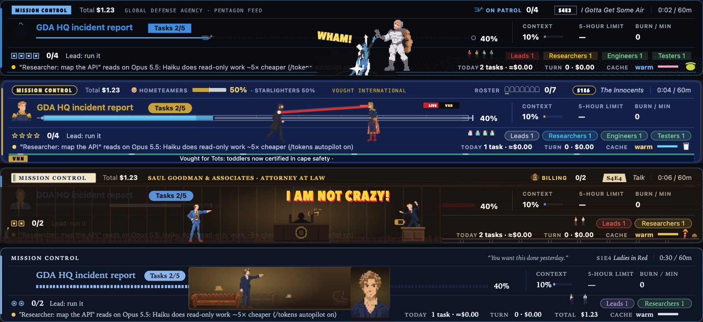
</p>

<h3 align="center">See everything Claude is doing. Live.</h3>

<p align="center">
  A live HUD and dashboard for <a href="https://claude.com/claude-code">Claude Code</a> (desktop app and CLI):<br>
  who's working, on what, how far along, and what it costs.
</p>

<p align="center">🎤 <b>Presented at Claude Code Meetup #13</b></p>

<p align="center">
  <a href="#-choose-your-edition">Download</a> ·
  <a href="#-what-mission-control-does">Features</a> ·
  <a href="#-what-the-cyberpunk-skins-add">Cyberpunk Skins</a> ·
  <a href="#-skin-showcase">Skins</a> ·
  <a href="#-motion-fights-and-3d">Motion and fights</a> ·
  <a href="#-easter-eggs">Easter eggs</a> ·
  <a href="#-install">Install</a> ·
  <a href="#-commands">Commands</a>
</p>

<p align="center">
  
  
  
</p>

---

## 🎯 Choose your edition

<table align="center">
  <tr>
    <td align="center" width="50%" valign="top">
      <b>Mission Control Core</b><br>
      The live dashboard and eight skins (the default look included), free.<br>
      HUD band, pane, crew, Token Manager, crew mode, done chime, rich replies.
    </td>
    <td align="center" width="50%" valign="top">
      <b>Cyberpunk Skins</b> (Core + add-on)<br>
      Jack in, choom: your crew moves to Night City.<br>
      Four more skins, a pixel-art cast, Street Cred and Braindance.
    </td>
  </tr>
  <tr>
    <td align="center" valign="top">
      <a href="https://github.com/Chinchuan24/MissionControl/releases/latest/download/mission-control-core.zip">
        
      </a>
    </td>
    <td align="center" valign="top">
      <a href="https://github.com/Chinchuan24/MissionControl/releases/latest/download/mission-control-cyberpunk.zip">
        
      </a><br>
      <sub>Have Core already? <a href="https://github.com/Chinchuan24/MissionControl/releases/latest/download/cyberpunk-skins-addon.zip">Get the add-on only</a>.</sub>
    </td>
  </tr>
</table>

<p align="center"><sub>Both zips are the full mod (Cyberpunk = Core + add-on). Unzip, <a href="#-install">point Claude Code at the folder</a>, restart.</sub></p>

> **Unofficial, non-commercial fan project.** Not affiliated with, endorsed by or sponsored by CD PROJEKT S.A., CD PROJEKT RED, Studio Trigger or Netflix. Cyberpunk 2077, Cyberpunk: Edgerunners, Edgerunners 2 and all related names, characters and terms belong to their respective owners and are used as fan homage only. The Mentalist and its characters belong to CBS and Warner Bros. Television, used as fan homage only. Breaking Bad and Better Call Saul and their characters belong to Sony Pictures Television and AMC, used as fan homage only. Invincible and its characters belong to Robert Kirkman, Cory Walker, Ryan Ottley, Image Comics, Skybound and Amazon MGM Studios, used as fan homage only. The Boys and its characters belong to Eric Kripke, Garth Ennis, Darick Robertson, Sony Pictures Television and Amazon MGM Studios, used as fan homage only; the pixel art is original (text prompts only, no stills, no actor likenesses). The MIT license covers this project's code, not those properties. Removal requests: open an issue.

---

## 🧭 What Mission Control does

Claude works in steps, calls tools and spins up sub-agents. Mission Control shows it all at a glance.


- 📊 **HUD band** above the prompt, always on: the boss, the task, what it's doing now, a progress gauge, and the session **Total** cost on every skin
- 🧪 **Readouts**: context, 5-hour limit, burn rate, tok/s, turn and total cost, prompt-cache countdown
- 👥 **Crew** and 🪜 **Steps**: every sub-agent by role, the plan as pips
- 💸 **Token Manager**: cost per task, cache hits, budget warnings; optional **Haiku autopilot** for read-only explorers
- 🧊 **Smart Keep-Warm**: refreshes the prompt cache just before it expires, only when that saves more than it costs (`/tokens warm on`)
- 🗓️ **Spend card**: what Today, this week (Mon–Sun), one calendar month or your own date range cost, read from Claude Code's own history (`/tokens spend week`, `/tokens spend month 2026-06`, `/tokens spend 2026-10-01 2026-10-15`); `/tokens export` saves the period as a FinOps-style CSV in Downloads ([Athena sample](docs/athena.sql))
- 🚀 **Crew mode**: big jobs get split across sub-agents automatically (`/autocrew`)
- 🧠 **Staffing brain** (on by default): the Manager picks each worker's model and effort, with a one-line why on its card. A model or effort you name wins (`/tokens brain on|off`)
- ⏱️ **Timekeeper** (on by default): every job (60 min) and sub-agent (20 min) gets a time budget; it warns at 80% and flags overruns once (`/timekeeper`)
- ⚡ **Ultra decided by** (Settings > 🦀 Crew, or `/tokens ultra manager|me`): with **Manager**, the main session flags `ultra: true` on only the plan tasks that really need max effort and a deep check (hard design, tricky debugging, security, risky migrations). An agent whose description matches a flagged task starts on Ultra and the card reads "max + Ultra (Manager's call)". Your ⚡ button always wins, and role rules still apply. **Me** (default) ignores the flags.
- 🚨 **Stuck alarm** (2 min quiet) and 🔔 **done chime** (toast, notification, sound)
- 🧾 **Rich replies**: diffs, code, tables, math and mermaid as cards
- 🌍 **7 currencies**, **3 languages** (English, Russian, Hebrew)
- 🧱 **Steady while it works**: progress bars no longer jump to 100% and back when a sub-agent ends a turn, the band's top row never overlaps itself or runs off the edge, and an agent card you collapsed stays collapsed
- 🎨 **Skins**: 8 in Core (the default look and 7 more), 4 more in the Cyberpunk add-on, or [make your own](skins/README.md). The **Skins** tab is a gallery: one preview card per skin (its colours, mascot and palette), grouped under Classics, TV shows, Night City and Your skins
- 🎬 **[Motion, fights and 3D](#-motion-fights-and-3d)**: every skin moves, most have a fight or stand-off that plays now and then, and a few have a head or prop that turns. Plain skins stay calm
- ⚙️ **Settings cards**: Money, Machine Guard, Crew, Look and feel, and Billing, each a card in the skin's colours with one row per setting and drawn on/off toggles
- 🥚 **[Easter eggs](#-easter-eggs)** in every skin

<details>
<summary><b>The <code>/missioncontrol</code> pane, section by section</b></summary>
<br>

| Section | What's in it |
|---|---|
| **Usage** | Your limits, plus tokens per model for this session and all time |
| **Today** | Tasks, agents, tokens and cost |
| **Workflow** | The plan's steps, live |
| **Manager** | The boss card: model, effort, sub-agents, cost and time |
| **Token Manager** | Burn rate, cost per task, cache hits, budget warnings, optional Haiku autopilot and Smart Keep-Warm |
| **Crew** | Every agent at work by role in one long list, however big the crew, the newest finished ones beside them and one "+N more finished" row for the rest of a long session, plus a hierarchy from the manager down. When a skin's cards add up to more than the app can draw, the pane gives up its decoration a part at a time (replay log first), never the whole pane. **Collapse** folds the whole list into a short view; **▾ Finished** folds finished agents and steps into one line each. Both are remembered. |
| **Memory** | Answer rules Claude follows in every session (`/prefs`) |
| **Settings** | Cards: 💰 Money (budget per task, daily cap) · 🛡 Machine Guard (RAM limit, max agents, RAM per agent, kill switch) · 🦀 Crew (crew mode, one-shot plans, Ultra decided by, Smart staffing, Staffing brain, Timekeeper) · 🎨 Look and feel (skin, currency, simple band, calm mode, sounds, spoken status, open on start) · 💳 Billing (who pays, API key) |

</details>

<details>
<summary><b>🧊 Smart Keep-Warm, how it works</b></summary>
<br>

Claude's prompt cache keeps your conversation for an hour after each answer. Reading it costs about a tenth of the normal price; once it expires, your next prompt pays to write the whole conversation again (about 2× the normal price). Keep-Warm sends one tiny side request a few minutes before the hour runs out, so the cache stays warm.

- 🙈 **Never in your chat**: the refresh is a side request over your own conversation; nothing is added to it.
- 🧮 **Only when it pays**: it goes out only when the expected saving beats its cost by at least $0.05. Small conversations are left alone.
- 🏃 **Knows when you'll be back**: while agents or background tasks still run, you're sure to return, so it keeps going (up to 12 refreshes). Idle, it stops after 3 (close to three more warm hours).
- 🗜️ **Skips a dying context**: at 85%+ context a `/compact` is coming, which rewrites the cache anyway.
- 📊 **Shows its work**: each refresh's cost and saving in a toast and in the Token Manager; `/tokens` totals them.
- ⏸️ **Pauses itself** if a refresh finds the cache already gone, until your next prompt.

Off by default: turn it on with `/tokens warm on`. On a Pro or Max plan there's no per-token bill, so each refresh uses a little quota instead; the gain is mostly speed.

</details>

---

## 🌃 What the Cyberpunk Skins add

The add-on swaps the crabs for a pixel-art cast, moves the HUD to Night City and adds a progression system.


| Feature | Core | Cyberpunk |
|---|:---:|:---:|
| HUD band, pane, crew, Token Manager, crew mode, done chime, rich replies | ✓ | ✓ |
| 8 core skins: default, Crab Classic, Caliper, The Mentalist, Breaking Bad, Better Call Saul, Invincible, The Boys; custom JSON skins | ✓ | ✓ |
| **Cyberpunk Edgerunner**, **Lucy · Edgerunners**, **Arasaka**, **Edgerunners 2** skins | — | ✓ |
| **Edgerunners 2** (fan homage): D's optics, a cobalt glass HUD, Roman's Tape, and Capri who walks in now and then | — | ✓ |
| Pixel-art cast: David, Lucy, Rebecca, Maine, Kiwi, Johnny… Saburo and Adam Smasher on Arasaka | — | ✓ |
| **Street Cred**: XP per job, ranks NOBODY → LEGEND OF THE AFTERLIFE, 9 badges | — | ✓ |
| **Braindance**: replay the session, every tool call a mark | — | ✓ |
| Breach Protocol card, NCPD heat stars, CYBERPSYCHOSIS / MAXTAC warnings | — | ✓ |
| Night City skyline, Relic glitch, Sandevistan afterimages, the Afterlife | — | ✓ |
| Fights: the MaxTac raid, Lucy's ICE duel, the Arasaka boardroom, D vs a cyberpsycho, and a layered skyline with rain | — | ✓ |
| Per-skin sound packs, eddies (€$), radio, street slang | — | ✓ |

---

## 🎨 Skin showcase

Pick one in the **Skins** tab (a gallery of preview cards), with `/skins` (a live picker) or `/skin <id>`. Each skin restyles the band, the pane, the chat's tool rows and the spinner.

| Skin | id | One line |
|---|---|---|
| default | `default` | Keeps the app's own look. Just the data. |
| 🦀 Crab Classic | `crab-classic` | The original. A working crab in costume for every role. |
| 📐 Caliper | `caliper` | Graphite and ice: a dial, a ruler, one blue. Dark, light or auto. |
| 🕵️ The Mentalist | `mentalist` | Jane and the CBI team in black, navy and crisp white. |
| ⚗️ Breaking Bad | `breaking-bad` | Mr. White, Jesse and the lab, crystal blue on desert green-black. |
| ⚖️ Better Call Saul | `better-call-saul` | Saul's strip-mall law office, powder blue and gold on dark walnut. |
| 💥 Invincible | `invincible` | The comic page: Mark and Omni-Man fight across the panels. |
| ⭐ The Boys | `the-boys` | Vought's broadcast console in navy and gold: an approval meter that follows your tests, a VNN news crawl, spin on every error. Then the Boys hijack the feed. |
| 🟡 Cyberpunk Edgerunner | `cyberpunk-2077` | Neon yellow, cyan and hot red. David leads the crew. |
| 🌙 Lucy · Edgerunners | `lucy-edgerunners` | Rose-pink and cyan under the moon. Lucy runs the net. |
| 🔴 Arasaka | `arasaka` | Corporate red and black. Saburo at the top, Smasher on call. |
| ✂️ Edgerunners 2 | `edgerunners-2` | D's optics: a cobalt glass HUD. Capri visits. |

The first eight ship with Core; the last four need the Cyberpunk add-on. Seven more skins are hidden: see [Easter eggs](#-easter-eggs).

<details open>
<summary><b>⚪ default</b> · Core</summary>
<br>

The app's own colours and fonts, with no costumes or effects. Just the data.


</details>

<details>
<summary><b>🦀 Crab Classic</b> · Core</summary>
<br>


</details>

<details>
<summary><b>🟡 Cyberpunk Edgerunner</b> · add-on</summary>
<br>

Night City HUD: neon yellow, cyan and hot red, cut corners and scanlines. **David** leads. **Lucy, Rebecca, Maine, Dorio, Kiwi, Pilar, Falco and Johnny** take the roles; chooms and NPCs do the work.


</details>

<details>
<summary><b>🌙 Lucy · Edgerunners</b> · add-on</summary>
<br>

Moonlit netrunner: rose-pink and cyan on deep violet, with the moon in the skyline. **Lucy** leads, and **David** rides with the crew.


</details>

<details>
<summary><b>🔴 Arasaka</b> · add-on</summary>
<br>

Corporate red and black. **Saburo** at the top. **Adam Smasher**, handlers, agents, netrunners, guards, a cyborg and a captive **Johnny** under him. Troopers, salarymen and drones on the floor. The tower stands in the skyline.


</details>

<details>
<summary><b>🛠 Make your own skin</b></summary>
<br>

Skins are small `.json` files; see [`skins/README.md`](skins/README.md) for every field. They load from, in order:

1. the folder you used last
2. a `Custom Claude Skins/` folder in your working folder
3. this repo's `skins/` examples

Copy an example, give it a new `id`, edit it, then run `/skin reload` and `/skin <id>`.

Or skip the editing: `/skin new ocean sunset` drafts one for you, and `/skin check <file>` checks one. See [`docs/SKINS.md`](docs/SKINS.md) for the guide, the schema and how to share a skin (Skin jam).

</details>

---

## 🎬 Motion, fights and 3D

Every skin has its own motion, built on **one shared stage engine** ([`hooks/stage/`](hooks/stage/README.md)): timelines, particles, a camera with shake and hit-stop, light passes, parallax backdrops, wipes and one scheduler that keeps rare things rare. Skins use the same tools and keep their own look.

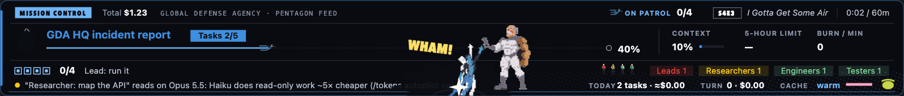

*Invincible, new suit: MARK VS CONQUEST on the band. The fight keeps to the clear stretch between the title and the numbers.*

### Fights and stand-offs

Most skins have one. They start by themselves, while a job runs and a little less often at rest. Try any of them now with `/missioncontrol play <name>` (with no name it lists what the worn skin can play).

| Skin | What plays | Replay name |
|---|---|---|
| 🦀 Crab Classic | The claw-off: two crabs, one coin | `claw-off` (also `clack`) |
| 🕵️ The Mentalist | THE READ, a card-trick mind duel; the daily Parlour Reveal | `the-read`, `parlour-reveal`, `case-closed` |
| ⚗️ Breaking Bad | The Desert Stand-off; the daily pizza on the roof | `desert-standoff`, `pizza-on-the-roof`, `yeah-science` |
| ⚖️ Better Call Saul | CHICANERY, the bar hearing: Jimmy against Chuck | `chicanery`, `gus`, `car`, `lalo`, `saul3d`, `namaste`, `ding`, `1216` |
| 💥 Invincible | THE FIGHT in three cuts; MARK VS CONQUEST (new suit: say `new suit` first) | `the-catch`, `jet-flick`, `every-angle`, `conquest` (older: `fight`, `showdown`, `think`, `eve`, `oliver`, `cecil`, `newsuit`, `classic`) |
| ⭐ The Boys | Butcher vs Homelander; A-Train races the progress bar; THE AMBUSH | `offthebooks`, `race`, `ambush`, `ambush-a`, `ambush-b`, `ambush-c` (about 90 more: `/missioncontrol play`) |
| 🟡 Cyberpunk Edgerunner | The MaxTac raid; David's Sandevistan | `maxtac`, `sandevistan`, `preem` |
| 🌙 Lucy · Edgerunners | Lucy's ICE duel; the dive into the Net | `ice-duel`, `dive`, `to-the-moon` |
| 🔴 Arasaka | The boardroom stand-off; the hanko seal | `boardroom`, `hanko` |
| ✂️ Edgerunners 2 | D vs a cyberpsycho, cut like a film | `cyberpsycho`, `slate`, `cut` |
| ⚪ default · 📐 Caliper | No fight, on purpose. Quiet state motion only | `cards`, `shake` (default) · `zero`, `settle` (Caliper) |

The hidden skins have their own (see the spoilers under [Easter eggs](#-easter-eggs)).

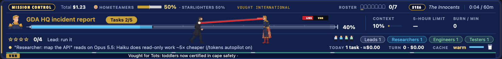

*The Boys: Butcher vs Homelander. Every Boys fight is "censored live TV": a LIVE bug, a discretion slate, a mosaic over each hit.*

**How often:** `/missioncontrol fights often | normal | rare | off`. The setting is saved.

| Level | While a job runs | At rest |
|---|---|---|
| `often` (default) | one every 7-10 min | one every 15-20 min |
| `normal` | one every 15-20 min | none |
| `rare` | one every 30-45 min | none |
| `off` | none by themselves | none |

Replays work at every level. At `often` and `normal`, no fight starts in a job's first 90 seconds (the job-start acts play then). A skin with several fights takes them in turns. They draw in the band's clear stretch and keep off the percent, cost, context and timers; one act plays at a time.

### 3D, plainly

The mod draws pictures. It cannot run live 3D, and nothing here is rendered live. The 3D you see is **pre-rendered turnarounds**: a model drawn from several angles, with the frames played in order. A symmetric prop needs only half the angles, since the engine mirrors the rest. Where it is used:

- **Heads that turn:** Saul's head (`/missioncontrol play saul3d`), and the Boys' bust when the feed switches mode.
- **Props that turn:** the crystal on Breaking Bad, the Boys' shield and bust, Arasaka's tower and Lucy's moon.
- **Depth without 3D:** parallax skylines with rain, light passes and card flips.

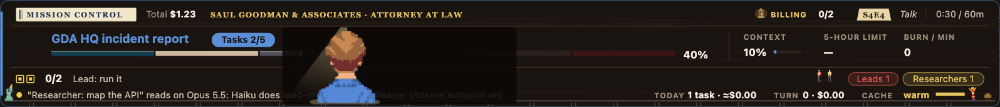

*Better Call Saul, `saul3d`: one frame from the turn.*

### A short wipe when the skin changes

`/skin <name>` and the picker play a 0.7-second wipe over the band and the top pane cards, in the new skin's colours. It is see-through, so the numbers stay readable. It skips itself while a big act is drawn, so at the `often` setting some switches show no wipe.

### Calm by design, and honest limits

- The **plain skins stay calm on purpose**: default, Caliper and Crab Classic are what you leave on while you work. Default and Caliper have no fights, Crab Classic only its small claw-off, and nothing on them animates a filter at rest. If your OS asks for reduced motion, acts and idle loops are drawn as still frames.
- **Narrow bands lose some fights.** On the Cyberpunk skins no band fight plays at 450 px wide, and Edgerunners 2 skips it at 600 px too (the pane version still plays). The Boys' fighters shrink on a narrow band (about 69 px at 1250, 45 below 900).
- A few acts dim or cross the prose lines (the activity text, the tip) for a few seconds. Numbers, labels and chips stay clear.

<details>
<summary>More pictures: a daily set piece and the Cyberpunk raid</summary>
<br>

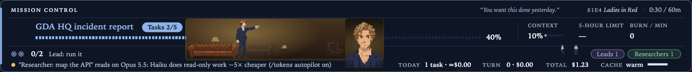

*The Mentalist: the Parlour Reveal, a daily set piece (`parlour-reveal`).*

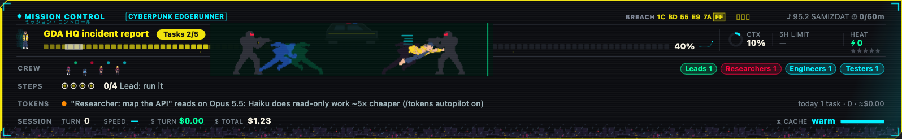

*Cyberpunk Edgerunner: the MaxTac raid (`maxtac`).*

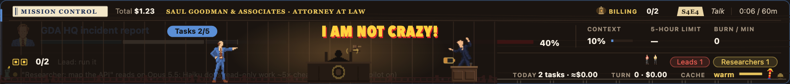

*Better Call Saul: CHICANERY (`chicanery`).*

</details>

---

## 🥚 Easter eggs

Type a word anywhere in your prompt (any case) while its skin is on.

| Skin | Type | What happens |
|---|---|---|
| Invincible | `think, mark` | Omni-Man drops in: "THINK, MARK." |
| Invincible | `guardians` | The Guardians take on Omni-Man |
| Invincible | `multiverse`, `invincible war` or just `what have i done` | Rifts open and a flock of evil Marks flies across |
| Invincible | `new suit` (or `season 3`/`4`) · `classic suit` (or `old suit`, `season 1`/`2`) | Swap to the S3 suit's black and blue, and back |
| The Boys | `shock and awe, my son` · `never meet your heroes` | SIGNAL HIJACKED: OFF BOOK (Butcher's black and red), and back ON BRAND |
| The Boys | `7spn` | The test scoreboard comes back for a look |
| The Boys | 60 phrases from the show (`oh, diabolical`, `hughie, blink`, `turbo rush`, `vought on ice`…) | See the spoiler list below |
| Better Call Saul | `chicanery` | The bar hearing plays: Jimmy against Chuck, "I AM NOT CRAZY!" |
| Better Call Saul | `1216` | The number flip |
| Better Call Saul | `namaste` | A bowling ball meets Howard's car |
| Better Call Saul | `ding` | Hector's bell rings |
| Better Call Saul | `saul3d` | Saul's head turns all the way round (pre-rendered frames) |

**Replays:** `/missioncontrol play <name>` plays one now; with no name it lists what the worn skin can play. Every fight's name is in the [table above](#-motion-fights-and-3d). Invincible also has `fight`, `showdown`, `think`, `eve`, `oliver`, `cecil`, `newsuit`, `classic`. The Boys has about 95 (every typed egg, the event eggs, `ambush`, `ambush-a`/`-b`/`-c`, the roamers, the fights).

**They also play by themselves:** daily Invincible and The Boys set pieces, THE AMBUSH, cameos while jobs run, show toasts on job and tool events, and something extra on most skins when context passes 85% and 95%.

**Fights:** every skin's fights and stand-offs pop up by themselves, rotating through the skin's fights. `/missioncontrol fights often` (the default: one every 7-10 min while a job runs, every 15-20 min at rest), `normal` (15-20 min, jobs only), `rare` (30-45 min, jobs only) or `off` (replays only); `/missioncontrol fights` shows the setting, which is saved. More in [Motion, fights and 3D](#-motion-fights-and-3d).

<details>
<summary>Spoilers: hidden skins</summary>
<br>

Hidden skins are not in the gallery, the picker or `/skin` until you wear one.

| Hidden skin | How to find it | Needs |
|---|---|---|
| Red John | type `tyger tyger` on The Mentalist (a title card paints itself first), or `/skin red-john`; `patrick jane` goes back | Core |
| Heisenberg | type `say my name` (or `what's my name`) on Breaking Bad: a full animation plays and ends on "You're goddamn right.", then the skin turns. Or `/skin heisenberg`; `walter white` goes back | Core |
| GENE | type `takavic` on Better Call Saul: the colour drains out of the band, then the skin is grey. Or `/skin gene`; `saul goodman` (or `better call saul`) goes back | Core |
| CAPRI (Edgerunners 2's CAPRI mode) | type `capri` or `0+2=1` on Edgerunners 2, answer one of Capri's takeovers with `hi capri` within a minute, or `/skin capricorn`; `bye capri` goes back | Cyberpunk add-on |
| SAMURAI | `/skin samurai` only (no typed word) | Cyberpunk add-on |
| SOLID GOLD | type `solidgold` or `soldier boy` on The Boys, or `/skin solidgold`; `back on ice` goes back. Its own badge and its own secret flag | Core |
| THIS MEANS NOIR | type `this means noir` on The Boys, or `/skin noir`; `curtain call` goes back. The silent one: a real quiet mode (toasts are `…`). Its own badge and its own secret flag | Core |

The Saul words also work on GENE.

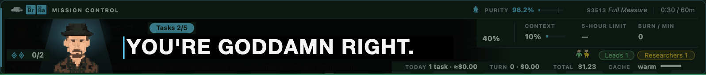

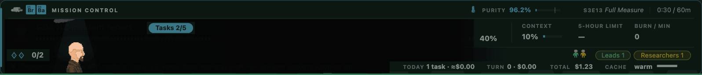

*SAY MY NAME, from the hat drop to the title card. The GIF is a sequence of rendered frames at their real timing, not a screen recording, so it is choppy.*

</details>

<details>
<summary>Spoilers: the hidden skins' fights and set pieces</summary>
<br>

Each plays by itself and has a replay name (`/missioncontrol play <name>` while the skin is worn). They follow the same `/missioncontrol fights` setting as the rest.

| Hidden skin | What plays | Replay name |
|---|---|---|
| Red John | The man in the dark coat walks by (a red rim on the figure, no words); the Tyger Tyger title card paints itself; the job-done smiley | `walk-by`, `tyger-tyger`, `still-watching` |
| Heisenberg | SAY MY NAME (stare, the hat drops, a turn, "You're goddamn right."); the Desert Stand-off; the job-done cheer. His hat logo also turns once an hour | `say-my-name`, `desert-standoff`, `one-who-knocks` |
| GENE | Everything Better Call Saul has, in grey, with film grain, a NIPPY! cheer and CHICANERY | `chicanery`, `saul3d`, `namaste`, `ding`, `1216`, `gus`, `car`, `lalo` |
| CAPRI (Edgerunners 2's CAPRI mode) | Capri vs D for control of the HUD: a split screen, then "my HUD, choom." | `capri-vs-d`, plus `cyberpsycho`, `slate`, `cut` |
| SAMURAI | The "2023" gig, once a day at 20:23 while a job works, ending on the rocker; the amp shockwave cheer | `gig-2023`, `never-fade-away` |
| SOLID GOLD | Homelander vs Soldier Boy, the laser into the shield (its first unlock), plus every Boys act in gold | `reunion` and the Boys' list |
| THIS MEANS NOIR | A silent-movie fight, Kimiko vs Black Noir, with intertitles and an iris. Typed `curtain up` plays it; `curtain call` goes back | `curtainup`, `curtain` and the Boys' list |

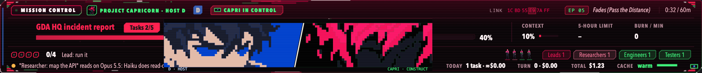

*CAPRI mode: Capri vs D for the HUD. The cut-in covers the middle strip and leaves the task title, bar and numbers alone.*

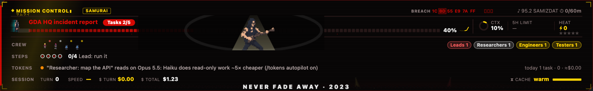

*SAMURAI: the 2023 gig.*

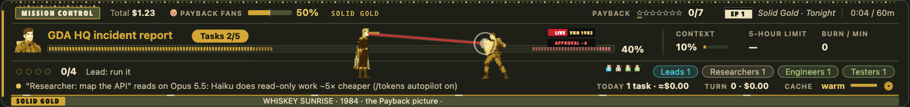

*SOLID GOLD: the laser into the shield.*

</details>

<details>
<summary>Spoilers: The Boys, every egg</summary>
<br>

**Typed** (the whole phrase, any case, while The Boys is on; the prompt goes on unchanged). One act at a time, each on the band and a pane card.

| # | Type | Act |
|---|---|---|
| T1 | `oh, diabolical` | diabolical |
| T2 | `ashley, look at me` | lookatme |
| T3 | `shock and awe, my son` | hijack |
| T4 | `never meet your heroes` | onbrand |
| T5 | `i can do whatever i want` (alone, or ending in `!`) | whatever |
| T6 | `pinocchio is stayin' put` | whale |
| T7 | `timothy the octopus` | timothy |
| T8 | `vought on ice` | ice |
| T9 | `laser baby` | laserbaby |
| T10 | `mon cœur` | dance |
| T11 | `buster beaver` | beaver |
| T12 | `seen the memes` | memes |
| T13 | `billy joel` | joel |
| T14 | `solidgold / soldier boy` | solidgold |
| T15 | `back on ice` | backonice |
| T16 | `tall glass of milk` | milk |
| T17 | `compound v` | compoundv |
| T18 | `hughie, blink` | blink |
| T19 | `turbo rush` | turbo |
| T20 | `training a-train` | training |
| T21 | `brave maeve` | bravemaeve |
| T22 | `seven on 7` | sevenon7 |
| T23 | `dawn of the seven` | premiere |
| T24 | `fun cut` | funcut |
| T25 | `invisible force` | invisible |
| T26 | `this means noir` | noirmode |
| T27 | `vivant! / cirque de vought` | vivant |
| T28 | `not without my dolphin` | dolphin |
| T29 | `ambrosius` | ambrosius |
| T30 | `american hero` | americanhero |
| T31 | `rock my kiss / super-sweet (alone)` | rockmykiss |
| T32 | `smartest person on the planet` | knight |
| T33 | `wakey wakey` | wakey |
| T34 | `class dismissed (alone)` | dismissed |
| T35 | `you guys are the real heroes` | realheroes |
| T36 | `you're bad product` | badproduct |
| T37 | `really a pharmaceutical company` | pharma |
| T38 | `storage boy` | storage |
| T39 | `red scare / vought rising` | redscare |
| T40 | `godolkin` | godolkin |
| T41 | `little cricket (alone)` | cricket |
| T42 | `monster club` | puppets |
| T43 | `v52 expo` | expo |
| T44 | `good boy, terror` | terror |
| T45 | `full roster (alone)` | fullroster |
| T46 | `hometeamers` | hometeamers |
| T47 | `starlighters` | starlighters |
| T48 | `saving america` | savingamerica |
| T49 | `vought for tots` | tots |
| T50 | `planet vought` | planetvought |
| T51 | `it's what clara would have wanted (spoilers on)` | clara |
| T52 | `cracked mirror` | mirror |
| T53 | `it's a deepfake` | deepfake |
| T54 | `the boys are back in town` | walk |
| T55 | `tell you about nicaragua` | nicaragua |
| T56 | `payback (alone)` | payback |
| T57 | `red thunder` | redthunder |
| T58 | `vought classic` | vclassic |
| T59 | `truthbomb` | truthbomb |
| T60 | `7spn` | scoreboard |

Also on THIS MEANS NOIR: `curtain up` plays its silent fight, and `curtain call` goes back to The Boys.

**Events** (they play by themselves from what Claude Code does):

| # | When | Act |
|---|---|---|
| E1 | a test run fails | scorch |
| E2 | tests fail twice in a row | disgusted |
| E3 | the failing test passes | regen |
| E4 | a job is cancelled (Esc) | sweep |
| E5 | the context is compacted or cleared | blackout |
| E6 | a tool is refused permission | legalno |
| E7 | `git push --force` | rewind |
| E8 | a plan is approved (ExitPlanMode) | knight |
| E9 | the first prompt of the day | wakey |
| E10 | context passes 85% | toast / BREAKING |
| E11 | context passes 95% (once a session) | lookatme |
| E12 | a job of 3+ minutes ends (and a tool call over 60 s shows the PREMIERE FACE) | toast / BREAKING |
| E13 | 4+ tools at once | turbo |
| E14 | after midnight (midnight to 5 AM local) | toast / BREAKING |
| E15 | 10 min idle (20 min: a line once a session) | terror |
| E16 | the session passes $1, $5, $20 | toast / BREAKING |
| E17 | a subagent spawns (the first to finish gets a line) | recruit |
| E18 | 3 tool errors in a row | mirror |
| E19 | a Write creates a new file | blink |
| E20 | a test run with 0 failures | toast / BREAKING |
| E21 | lint/typecheck passes after failing | toast / BREAKING |
| E22 | WebFetch / WebSearch fails | fish |
| E23 | the daily cap is hit | toast / BREAKING |
| E24 | a test command starts (the 7SPN scoreboard) | toast / BREAKING |

**Daily set pieces** (seeded by your local day, once each in its window): RED SCARE newsreel 08:00–12:00 · VOUGHT ON ICE 09:00–22:00 · THE WHALE 10:00–21:00 · V52 EXPO 14:00–18:00 · THE PREMIERE 19:00–22:30 · the SOLID GOLD teaser 18:00–23:00 (never within 2 min of the premiere) · THE WALK 11:00–20:00 (twice in OFF BOOK) · BRAVE MAEVE pop-up (June only).

**Rare roamers** (one 6-minute slot, about two in three slots, never inside another act): Hughie (`…sorry, wrong room.`), Starlight, Kimiko (`[signs: hi]`: she signs, in closed captions), Frenchie, Black Noir (one time in five he carries a `1979` tape: the clue), A-Train, Terror, the fish school, Timothy, Ambrosius, Buster Beaver, the VNN blimp, and Butcher's `Oi.` (at most once per 48 min).

**THE AMBUSH** (12 s, band and CRISIS DESK, about every 30–45 min while a job works; three choreographies that take turns): A · THE LANDING, B · THE DROP (Noir first), C · THE SNATCH (A-Train steals your real progress bar, then brings it back: `my bad`).

**THE FIGHTS** (four, all "censored live TV"; they follow `/missioncontrol fights`, the Boys take them in turns by look): `offthebooks` (Butcher vs Homelander) and `race` (A-Train vs the progress bar) on ON BRAND, `offthebooks` on OFF BOOK, `reunion` on SOLID GOLD, `curtainup` on THIS MEANS NOIR. THE AMBUSH's fight turn plays only at `rare`.

**Replays:** `/missioncontrol play` lists all 95 names (96 on NOIR, which adds `curtain`), e.g. `ambush`, `ambush-c`, `offthebooks`, `reunion`, `scorch`, `sweep`, `blackout`, `shredder`, `teaser`, `kimiko`, `atrain`, `oi`, `whale`, `premiere`.

</details>


---

## 🛡️ Machine Guard

Stops a big crew from freezing your computer.

- **You set the RAM Claude may use** (Auto 50%, 25/50/75%, or a typed GB). Max agents = that RAM ÷ RAM per agent (≈0.5 GB, learned on your machine). 15 GB means up to 30 agents; no cap of 8.
- **Claude is told** the limit and the max in chat, and you get a toast when you change it.
- **Watches RAM live.** Over the limit, it refuses *new* agents and new heavy commands.
- **One budget across all your sessions.** Run 2 or 3 sessions and they share the same limit: the agent count adds up across them, and only one heavy command runs at a time on the whole computer.
- **One heavy command at a time** (tsc, tests, builds): a second one waits, up to 5 minutes.
- **🔪 Kill switch (On by default).** If Claude goes over its RAM limit, the guard stops the single biggest heavy process under Claude (a runaway `tsc`, a test run), then tells you and Claude. It never touches Claude itself, your apps, MCP servers or shells. Switch it off in Settings.
- **Tune it** in ⚙ Settings: "RAM Claude may use", "Max agents at once" (Auto, a list, or a typed number) and "Kill switch".
- **Claude's RAM counts every Claude process** on the computer: other sessions and the desktop app too.
- **See it** in the desktop pane: "🛡 RAM 9.1/15 GB · 3/30 agents" while working, plus "· 2 sessions" when more than one is live.

Details: [docs/MACHINE-GUARD.md](docs/MACHINE-GUARD.md)

---

## 🔒 Privacy: nothing leaves your machine

- **No network calls of its own.** Costs, the spend history and the crew view are all worked out locally, from Claude Code's own logs.
- **Model features are opt-in.** Keep-Warm, `/skin new` and the stuck-agent buttons use Claude Code's own connection, only when you turn them on or click them.
- **Your API key stays in the macOS Keychain.** The mod never stores it in its own files.
- **Check it yourself:** `scripts/check-privacy.sh` fails if network code ever appears.

Details: [docs/PRIVACY.md](docs/PRIVACY.md)

---

## ⚡ Install

### Fastest: one line

At the prompt of a terminal session:

```
/plugin install crab-progress --marketplace Chinchuan24/MissionControl
```

Or from a shell:

```
claude plugin install crab-progress --marketplace Chinchuan24/MissionControl
```

Answer `y` to add the marketplace, then pick a scope (user is first). In the desktop app, where `/plugin` does not run: click **+** next to the prompt box, then **Plugins**, **Add marketplace** with `Chinchuan24/MissionControl`, then **Add plugin**. This installs the full mod, Cyberpunk add-on included. Then run `/missioncontrol`.

### By hand, from a zip or a clone

**1. Get it** (one of):

- Download a zip above and unzip it anywhere. It holds one folder, `mission-control/` (the one with `.claude-plugin/` inside): that is the folder to point Claude Code at. Windows' "Extract All" may wrap it in a second folder; use the inner one. Or
- clone the repo (this gets everything, add-on included):
  ```
  git clone https://github.com/Chinchuan24/MissionControl.git
  ```
  A clone has no `mission-control/` folder: point Claude Code at the cloned `MissionControl/` folder itself (it holds `.claude-plugin/`).

**2. Point Claude Code at the folder** in `~/.claude/settings.json` (Windows: `C:\Users\<you>\.claude\settings.json`):

```json
{
  "env": {
    "CLAUDE_CODE_PLUGIN_DIRS": "/path/to/mission-control",
    "CLAUDE_CODE_PLUGIN_DIR_WATCH": "1"
  }
}
```

- **Windows:** write the path with forward slashes or doubled backslashes, e.g. `"C:/Users/<you>/mission-control"` or `"C:\\Users\\<you>\\mission-control"`. A single `\` breaks the JSON.
- Several mod folders: separate them with `;` on **Windows**, `:` on **macOS / Linux**.
- **WSL:** the CLI there is Linux: use the WSL `~/.claude/settings.json`, `:` separators and `/mnt/c/...` paths.
- Keep the mod on a local drive: network and `\\wsl.localhost` paths can hide the skins and the add-on.
- `CLAUDE_CODE_PLUGIN_DIR_WATCH=1` reloads the mod when its files change.

**3. Restart Claude Code**, then run `/missioncontrol` and `/skins`. On a Mac, quit the desktop app with ⌘Q and open it again.

<details>
<summary><b>Adding the Cyberpunk add-on to an existing Core install</b></summary>
<br>

Unzip [`cyberpunk-skins-addon.zip`](https://github.com/Chinchuan24/MissionControl/releases/latest/download/cyberpunk-skins-addon.zip) **into** your Mission Control folder. It creates `addons/cyberpunk/`. Restart Claude Code, then pick a skin with `/skins`.

On a Mac, double-clicking the zip unzips it into a folder of its own, and dragging `addons/` onto your install in Finder replaces the folder instead of merging it. Unzip it from Terminal instead:

```
unzip -o ~/Downloads/cyberpunk-skins-addon.zip -d /path/to/mission-control
```

On Windows, "Extract All" also makes a folder of its own. In PowerShell instead:

```
Expand-Archive -Force "$env:USERPROFILE\Downloads\cyberpunk-skins-addon.zip" -DestinationPath "C:\path\to\mission-control"
```

</details>

- Works on Windows, macOS and Linux.
- 🔈 Sounds play on macOS and in the Claude Desktop app; Linux/Windows terminals stay silent.
- Optional: the free **Rajdhani** font gives the true HUD look (otherwise your OS's own sans is used).

---

## 💻 Commands

| Command | What it does |
|---|---|
| `/missioncontrol` | Open Mission Control (Settings at the bottom) |
| `/missioncontrol billing` | Pay with your own Claude API credits instead of the plan: 4 steps, key kept in the macOS Keychain ([security notes](docs/SECURITY-billing.md)) |
| `/missioncontrol currency <code> [rate]` | Costs in `USD` (the default), `AUTO` (eddies on the cyberpunk skins), `EDDIES`, `EUR`, `GBP`, `JPY`, `MYR` or `SGD`; optional rate per US dollar |
| `/missioncontrol oneshot <on\|off\|ask>` | Once you approve a plan: do it all and report once (`on`), one part at a time (`off`), or ask each time (`ask`) |
| `/missioncontrol fights <often\|normal\|rare\|off>` | How often fights and stand-offs play by themselves (default `often`: every 7-10 min while a job runs, every 15-20 at rest). With no word it shows the setting. Saved |
| `/missioncontrol play [name]` | Replay one of the worn skin's fights or set pieces now; with no name it lists them ([names per skin](#-motion-fights-and-3d)) |
| `/skins` | The skin picker, every skin as a live preview |
| `/skin` | `/skin` to list, `/skin <id>` to switch, `/skin off`, `/skin reload` |
| `/autocrew` | Crew mode: state, `on` (big jobs only), `always` (every job, small ones too), `off`, or `<context %>` to call the crew |
| `/tokens` | Token Manager report, `budget <dollars\|off>`, `autopilot <on\|off>`, `warm <on\|off>` (Smart Keep-Warm), `staffing <on\|off>` (cheapest model and effort per crew job), `brain <on\|off>` (🧠 Staffing brain, on by default: the Manager picks each worker's model and effort with a one-line why, shown on its card; a model or effort you name in your prompt wins, e.g. "opus, max effort"; Fable only when you ask for it; never lowered by role; with nothing picked the plan's tier fills it in, as the pane shows it (heavy: Opus · xhigh, careful: Opus · high, medium: Opus · medium, light: Opus · low, fable: Fable · high, Opus unless you name Fable), else Smart staffing's read when Smart staffing is on; a model you name counts only next to an ask ("use opus", "run it on sonnet", "opus, max effort"), not in a question or complaint; off passes the Agent call through untouched; `guardrails` is the old name and still works), `ultra <manager\|me\|add\|remove\|list\|off> [role]` (max effort and a deep check for a role; the card shows "max + Ultra"; `manager` lets the Manager flag the tasks that need it, `me` is the default), `spend today\|week\|month [YYYY-MM]\|<from> <to>`, `export [period]` (CSV in Downloads), `daily <dollars\|off>` (a soft daily cap), `receipt` (the job's markdown receipt, copied), `pr` (a PR cost badge, copied), `whatif` (this session re-priced under cheaper setups; Tab takes the best one's command), `rescue [retry\|nudge <n\|all>]` (quiet agents), `model <id or ARN> <opus\|sonnet\|haiku\|fable\|off>` (price a Bedrock application inference profile ARN, or any id with no model name, as that model; no args lists the map) |
| `/timekeeper` | Time budgets: state, `on\|off`, `job <minutes>`, `agent <minutes>` |
| `/prefs` | How Claude should answer you, in every session: `add <rule>`, `remove <n>`, `clear` |

---

<details>
<summary><b>🔧 Development</b></summary>
<br>

- `hooks/register.tsx`: hooks, UI and commands
- `hooks/cast.ts`: the pixel casts
- `hooks/stage/`: the shared motion engine every skin's acts, fights and idle loops are built on ([its README](hooks/stage/README.md))
- `hooks/eggs.ts` and the per-skin files (`invincible-eggs.ts`, `bettercallsaul-fx.ts`, …): the easter eggs
- `hooks/settingslook.ts`, `hooks/skinslook.ts`: the Settings cards' and Skins gallery's look
- `hooks/staffing-brain.ts`: the Staffing brain
- `hooks/richtext.ts`: diffs, tables, math and mermaid in replies
- `hooks/warm.ts`: Smart Keep-Warm's arithmetic (when a refresh pays)
- `hooks/billing.ts` and `scripts/anthropic-key-helper.sh`: the API key in the macOS Keychain and the `apiKeyHelper` link ([docs/SECURITY-billing.md](docs/SECURITY-billing.md))
- `hooks/spend.ts`: the spend card's periods, the transcript reader and per-day ledger, the CSV export
- Tests: `claude plugin test /path/to/MissionControl` (and `claude plugin validate …`)
- `.claude-plugin/types/` is generated on each machine by the CLI and is git-ignored.

</details>

## 🙏 Credits and license

- Started from **savvy-progress** by [johnnyvizz](https://github.com/johnnyvizz) ([claude-kit](https://github.com/johnnyvizz/claude-kit), MIT), since heavily reworked. Its copyright notice is kept in [LICENSE](LICENSE).
- Smart Keep-Warm was inspired by **cache-warmer** by [paulbkim-dev](https://github.com/paulbkim-dev) ([claude-code-cache-warmer](https://github.com/paulbkim-dev/claude-code-cache-warmer), MIT), itself after [Pi](https://github.com/earendil-works/pi)'s cache warmer: the side-request refresh, the expected-value rule and the idle limit. Mission Control's version is its own code, built into the Token Manager.
- Character designs and pixel art: most were created by [Chinchuan24](https://github.com/Chinchuan24) with [Higgsfield](https://higgsfield.ai), then converted to sprite grids. The Crab Classic crab is based on Pixel Clawd from DockCrab (Clawdy). The done chime (`assets/done.wav`) was synthesised for this project.
- **Open source under the [MIT License](LICENSE)**: use it, fork it, remix it. Game and show names, characters and terms are not covered.

<p align="center"><sub>Stop guessing what Claude is up to. Open Mission Control and watch.</sub></p>
